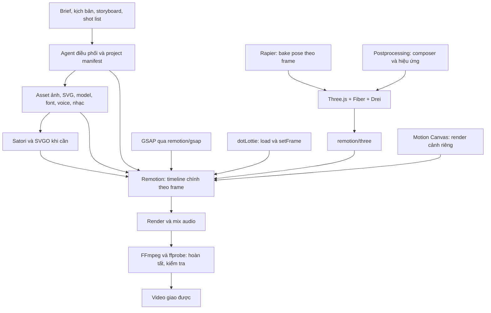

# Đánh giá 18 repo: có ghép thành “đoàn làm phim AI” được không?

Ngày khảo sát: 03/11/2026. Thư mục nguồn: `repos/` tính từ gốc workspace Piu Editor.

Cập nhật tổ chức workspace: các clone bên dưới đã được chuyển thành source vendored của một repo Git ở gốc; metadata `.git` cũ được lưu trong `.workspace/upstream-git/`. Xem [README](README.md), [bản đồ](docs/REPO-MAP.md) và [hướng dẫn bảo trì](docs/EXTENDING.md). Thông tin commit/shallow trong báo cáo và manifest mô tả lần tải nguồn ban đầu.

**Có thể xây dựng một xưởng làm video bằng code từ các thành phần này, nhất là motion graphics, video giải thích, quảng cáo sản phẩm và cảnh 3D. Nhưng riêng việc tải/cài cả 18 repo không tạo ra hệ thống tự làm phim A–Z.** Danh sách là bộ công cụ, có nhiều chức năng trùng nhau, còn thiếu quy trình sản xuất, nguồn tài nguyên và phần điều phối.

Phạm vi khảo sát: đọc README, manifest/package, tài liệu liên quan và các điểm mã nguồn quyết định khả năng tích hợp; không đọc toàn bộ mọi dòng của 18 dự án. Đây là đánh giá tĩnh về kiến trúc, chưa phải kết quả chạy thử tích hợp cả bộ hoặc xác nhận một model cụ thể như tên “Opus 5.5” trong bài đăng có thể tự hoàn thành phim.

## 1. Danh sách repo đã chọn

Mỗi repo nằm trong một thư mục riêng. Clone dùng `--depth 1 --single-branch`: có cây mã nguồn hiện tại, không tải toàn bộ lịch sử. Commit cụ thể và số file được lưu trong [repo-manifest.json](repo-manifest.json). Không cài dependencies, không tự động cài các skill vào hồ sơ agent; không tải riêng Git LFS hoặc submodule.

| # | Tên | GitHub | Thư mục | Công việc thực tế |
|---|---|---|---|---|
| 1 | Remotion Skills | [remotion-dev/skills](https://github.com/remotion-dev/skills) | [01-remotion-skills](repos/01-remotion-skills) | Hướng dẫn agent viết và render Remotion |
| 2 | GSAP Skills | [greensock/gsap-skills](https://github.com/greensock/gsap-skills) | [02-gsap-skills](repos/02-gsap-skills) | Hướng dẫn agent dùng GSAP |
| 3 | SVGO | [svg/svgo](https://github.com/svg/svgo) | [03-svgo](repos/03-svgo) | Tối ưu SVG có sẵn |
| 4 | Satori | [vercel/satori](https://github.com/vercel/satori) | [04-satori](repos/04-satori) | Kết xuất HTML/CSS/JSX giới hạn thành SVG |
| 5 | GSAP | [greensock/GSAP](https://github.com/greensock/GSAP) | [05-gsap](repos/05-gsap) | Timeline và tween thuộc tính |
| 6 | Anime.js | [juliangarnier/anime](https://github.com/juliangarnier/anime) | [06-animejs](repos/06-animejs) | Animation DOM/SVG/JS object |
| 7 | Motion | [motiondivision/motion](https://github.com/motiondivision/motion) | [07-motion](repos/07-motion) | Animation web, React, layout và gesture |
| 8 | dotLottie | [LottieFiles/dotlottie-web](https://github.com/LottieFiles/dotlottie-web) | [08-dotlottie-web](repos/08-dotlottie-web) | Phát/render asset Lottie và dotLottie |
| 9 | Remotion | [remotion-dev/remotion](https://github.com/remotion-dev/remotion) | [09-remotion](repos/09-remotion) | Composition, preview và render video bằng React |
| 10 | Motion Canvas | [motion-canvas/motion-canvas](https://github.com/motion-canvas/motion-canvas) | [10-motion-canvas](repos/10-motion-canvas) | Animation bằng generator TypeScript, editor, xuất video |
| 11 | Three.js | [mrdoob/three.js](https://github.com/mrdoob/three.js) | [11-threejs](repos/11-threejs) | Dựng và render cảnh 3D |
| 12 | React Three Fiber | [pmndrs/react-three-fiber](https://github.com/pmndrs/react-three-fiber) | [12-react-three-fiber](repos/12-react-three-fiber) | React renderer cho Three.js |
| 13 | Drei | [pmndrs/drei](https://github.com/pmndrs/drei) | [13-drei](repos/13-drei) | Helpers cho camera, model, text, ánh sáng… |
| 14 | Rapier | [dimforge/rapier](https://github.com/dimforge/rapier) | [14-rapier](repos/14-rapier) | Mô phỏng vật lý 2D/3D |
| 15 | Postprocessing | [pmndrs/postprocessing](https://github.com/pmndrs/postprocessing) | [15-postprocessing](repos/15-postprocessing) | Hiệu ứng hậu kỳ trên ảnh render Three.js |
| 16 | Howler.js | [goldfire/howler.js](https://github.com/goldfire/howler.js) | [16-howlerjs](repos/16-howlerjs) | Playback audio trên web |
| 17 | Mediabunny | [Vanilagy/mediabunny](https://github.com/Vanilagy/mediabunny) | [17-mediabunny](repos/17-mediabunny) | Đọc/ghi/chuyển đổi media, encode/decode theo môi trường |
| 18 | FFmpeg | [FFmpeg/FFmpeg](https://github.com/FFmpeg/FFmpeg) | [18-ffmpeg](repos/18-ffmpeg) | Encode, mux, filter, chuyển đổi và xử lý audio/video |

“dotLottie” không chỉ một repo: đây còn là định dạng và nhiều runtime. Chọn bản web để phù hợp bộ JavaScript/React này. “Rapier” cũng có engine và binding/wrapper; chọn engine gốc, trong snapshot hiện tại có `bindings/typescript`. “Postprocessing” chọn thư viện của pmndrs; khác với các addon EffectComposer trong Three.js.

## 2. Đọc từng repo và kiểm tra vai trò

### 01 — Remotion Skills: đúng vai “thầy dạy nghề”, không phải đạo diễn tự động

README liệt kê các nhóm hướng dẫn tạo project, markup, render, captions, multimedia, maps, nâng cấp và giấy phép. Nội dung bổ sung kiến thức cho coding agent; engine thực thi vẫn là Remotion và môi trường render.

Hai bằng chứng tích hợp quan trọng: [3d.md](repos/01-remotion-skills/skills/remotion-markup/3d.md) hướng dẫn dùng `@remotion/three` và điều khiển animation bằng `useCurrentFrame()`; [audio.md](repos/01-remotion-skills/skills/remotion-markup/audio.md) hướng dẫn thêm audio vào composition bằng `@remotion/media`. Như vậy không cần Howler để đưa nhạc vào video xuất.

**Đánh giá:** nên dùng khi chọn Remotion. Không tự cung cấp kịch bản, diễn viên, nhạc hay dịch vụ tạo giọng nói chỉ nhờ có skill.

### 02 — GSAP Skills: tài liệu sử dụng một bộ diễn hoạt

README và thư mục `skills/` chia nội dung thành core, timeline, ScrollTrigger, plugin, utils, React, performance và framework. Đây là hướng dẫn dùng GSAP đúng API và vòng đời component.

**Đánh giá:** có ích nếu dùng GSAP; kiến thức về scroll/gesture không tự chuyển thành timeline xuất video. Cần áp dụng theo ràng buộc frame của renderer. Giấy phép của repo skill không phải giấy phép của engine GSAP.

### 03 — SVGO: gọi là “hoạ sĩ” chưa chính xác

[README](repos/03-svgo/README.md) xác định chức năng là tối ưu SVG. Hàm `optimize(svgString)` nhận một hình đã tồn tại, rồi loại bỏ thông tin dư, rút gọn cấu trúc/path theo plugin.

[cleanupIds.js](repos/03-svgo/plugins/cleanupIds.js) có khả năng bỏ hoặc rút gọn ID. Nếu animation trỏ đến `#logo` hoặc các path cụ thể, tối ưu không cấu hình có thể làm hỏng selector. Nên giữ ID cần animate, tránh merge/biến đổi mất những lớp phải điều khiển riêng.

**Đánh giá:** công cụ chuẩn bị asset tốt; không vẽ tranh, tạo nhân vật hay tự sáng tác hình từ prompt.

### 04 — Satori: chuyên gia layout đồ hoạ tĩnh

[README](repos/04-satori/README.md) trình bày nhận JSX/HTML và CSS giới hạn để trả SVG. Không chạy đầy đủ React runtime; `useState`/`useEffect` không được hỗ trợ. Có layout engine riêng nên không bảo đảm giống browser 100%; cần đưa dữ liệu font vào.

**Đánh giá:** phù hợp title card, bảng số liệu, nhãn, thumbnail và thiết kế có template. Không phải engine minh hoạ sinh ảnh. Có thể tạo SVG trước rồi dùng SVGO và đưa vào Remotion; nhiều trường hợp React/HTML trong Remotion đã đủ, không cần thêm Satori.

### 05 — GSAP: phù hợp diễn hoạt có timeline

[README](repos/05-gsap/README.md) mô tả animation CSS, SVG, canvas, WebGL và JS object. [gsap-core.js](repos/05-gsap/src/gsap-core.js) cung cấp `seek`, `totalTime`, trạng thái pause và điều khiển timeline.

Đã đối chiếu tài liệu chính chủ: hiện có [@remotion/gsap](https://www.remotion.dev/docs/gsap), dựng timeline ở trạng thái pause rồi seek theo frame. Cầu nối này nằm trong monorepo Remotion, không phải một repo thứ 19 bắt buộc phải clone.

Đọc thêm [use-gsap-timeline.ts](repos/09-remotion/packages/gsap/src/use-gsap-timeline.ts) thấy wrapper chủ động kiểm tra callback, random không ổn định và tween không thuộc timeline; wrapper này giới hạn target vào element DOM/SVG. Không dùng nó như giải pháp mặc định để tween JS object/pose Three.js: nguồn cảnh báo trường hợp preview chạy nhưng still/render bị đứng.

**Đánh giá:** một lựa chọn hợp lý khi Remotion cần timeline phức tạp. Không để ticker tự chạy trong lúc render. Với chuyển động đơn giản, `interpolate`/`spring` của Remotion giúp giảm phụ thuộc.

### 06 — Anime.js: lựa chọn thay thế một phần GSAP

README mô tả animation DOM/CSS/SVG/JS object; snapshot dùng API V4. Trong [timer.js](repos/06-animejs/src/timer/timer.js), `seek(time)` cập nhật trạng thái và có thể resume nếu timer trước đó chưa pause. Vì vậy cần chủ động tắt autoplay/pause khi điều khiển bằng frame.

**Đánh giá:** dùng được qua adapter thời gian, nhưng chồng với GSAP. Không có lý do mặc định dùng cả hai để animate cùng một đối tượng. Cần kiểm tra đơn vị thời gian: mặc định Anime.js thường dùng mili giây, GSAP dùng giây.

### 07 — Motion: mạnh cho ứng dụng web tương tác

README và các package tách animation cho React và JavaScript, có layout/gesture và playback controls. Các hành vi dựa vào DOM measurement, hover, scroll, spring hoặc playback theo thời gian thực cần chuyển thành dữ liệu timeline rõ ràng trước khi render offline.

**Đánh giá:** hữu ích cho UI của trình biên tập/preview, hoặc animation đã có cơ chế điều khiển thời gian. Không nên coi việc thả component `<motion.*>` vào Remotion là bảo đảm xuất đúng từng frame. Thường là lựa chọn thay thế, không phải bộ phận bắt buộc bên cạnh GSAP và Anime.js.

### 08 — dotLottie Web: diễn viên hoạt hình có asset sẵn

README mô tả player chạy Rust/WASM, có wrapper React và các framework khác. [dotlottie.ts](repos/08-dotlottie-web/packages/web/src/dotlottie.ts) có `setFrame(frame)` gọi core render rồi vẽ canvas, là điểm có thể nối với timeline video.

**Đánh giá:** phù hợp icon/mascot/vector animation đã được tạo. Cần chờ WASM và asset load xong; tắt autoplay, ánh xạ FPS/thời gian về frame asset, xác nhận canvas đã vẽ rồi mới chụp. Player không tự sáng tác `.lottie` từ kịch bản. Audio nhúng phát trong player cũng cần đường đưa vào bản xuất, không mặc nhiên có trong MP4.

### 09 — Remotion: ứng viên làm trục dựng chính

README xác định tạo video bằng React. Monorepo có core composition, player, studio, renderer và các gói tích hợp. Đây là nơi phù hợp để thống nhất resolution, FPS, thời lượng, sequence, text, audio, captions và render.

**Đánh giá:** nên chọn làm bộ điều phối timeline ở tầng hình ảnh. Coding agent vẫn phải viết composition và orchestration bên ngoài. Một thư mục chứa mã nguồn Remotion chưa phải project video đã sẵn sàng chạy. Cần cài các package phát hành với phiên bản tương thích, browser renderer và môi trường cần thiết.

### 10 — Motion Canvas: một hướng làm phim bằng code khác

[README](repos/10-motion-canvas/README.md) mô tả thư viện TypeScript dùng generator cùng editor preview, chuyên vector animation giải thích và đồng bộ voice-over. JSX của Motion Canvas thuộc hệ renderer của nó, không phải mặc nhiên React DOM.

Trong [FFmpegExporterServer.ts](repos/10-motion-canvas/packages/ffmpeg/server/FFmpegExporterServer.ts), exporter nhận raw frame, thêm audio, xử lý offset/trim/gain, dùng `amix`, rồi xuất MP4 qua FFmpeg.

**Đánh giá:** có thể tự đảm nhiệm một pipeline video. Nếu dùng đồng thời Remotion, cách ghép rõ ràng nhất là render từng cảnh Motion Canvas thành clip hoặc image sequence rồi đưa vào timeline chính. Không nên nhét hai engine vào cùng một cây component và kỳ vọng chung clock.

### 11 — Three.js: trường quay 3D

README, `src/` và `examples/` cung cấp scene, camera, geometry, material, ánh sáng, loader và render. Đây là nền tảng dựng ảnh 3D, không tự dựng kịch bản quay hay tạo model nhân vật có rig.

**Đánh giá:** đủ làm sản phẩm quay 3D, text/shape 3D, môi trường procedural, chuyển động camera được lập trình. Vẫn cần model/texture/HDRI và chỉ đạo camera; video cuối đi qua renderer/muxer khác.

### 12 — React Three Fiber: nối Three.js với React

[README](repos/12-react-three-fiber/README.md) xác định là React renderer cho Three.js. [package.json](repos/12-react-three-fiber/packages/fiber/package.json) của snapshot cho thấy Fiber 9 yêu cầu React 19; đây là ràng buộc cần giữ cùng Drei và app.

[loop.ts](repos/12-react-three-fiber/packages/fiber/src/core/loop.ts) có vòng `requestAnimationFrame`, lấy delta và gọi subscriber `useFrame`. Có khả năng điều khiển frameloop nhưng không tự giải quyết mọi animation phụ thuộc lịch sử.

**Đánh giá:** rất hợp hệ React/Remotion, dùng qua [@remotion/three](https://www.remotion.dev/docs/three). Scene dùng `useCurrentFrame()` để tính pose, không cộng dồn `rotation += delta` cho bản xuất.

### 13 — Drei: phụ tá dựng cảnh, phải lựa chọn helper

[README](repos/13-drei/README.md) là bộ helper cho Fiber: camera, model, text, môi trường… Manifest hiện yêu cầu Fiber 9 và React 19.

Một ví dụ cụ thể: [Float.tsx](repos/13-drei/src/core/Float.tsx) sử dụng `Math.random()`, `useFrame()` và `state.clock.elapsedTime`. Vì vậy không thể kết luận tất cả component Drei đều cho kết quả lặp lại ổn định khi render video. Có thể dùng helper tĩnh, còn chuyển động nên viết lại theo frame và seed cố định.

**Đánh giá:** tích hợp tốt ở phần dựng cảnh. Không phải mọi abstraction của web tương tác đều phù hợp trực tiếp với offline render.

### 14 — Rapier: tổ vật lý, không phải máy quay

[README](repos/14-rapier/README.md) mô tả engine Rust cho vật lý 2D/3D, snapshot hiện có binding TypeScript trong `bindings/typescript`. Đó là mô phỏng vị trí, vận tốc, collider và va chạm; không tự tạo pixel.

Trong hệ React có thể dùng [react-three-rapier](https://github.com/pmndrs/react-three-rapier) làm wrapper, hoặc tự nối JS binding vào scene. Wrapper này nằm ngoài 18 repo đã chọn và không bắt buộc nếu viết adapter trực tiếp.

**Đánh giá:** chỉ cần khi có va chạm/chuyển động vật lý. Nên mô phỏng trước với timestep cố định, lưu pose theo frame rồi replay. Khi seek ngược hoặc render nhiều worker, chỉ gọi `world.step()` một lần theo frame đang yêu cầu sẽ cho trạng thái sai nếu thiếu lịch sử mô phỏng. Cần snapshot/reset/replay hoặc bake toàn bộ.

### 15 — Postprocessing: hậu kỳ cảnh 3D

[README](repos/15-postprocessing/README.md) dùng `EffectComposer`, `RenderPass`, `EffectPass`, có bloom, depth of field, SSAO, LUT và tone mapping. Phụ thuộc Three.js.

**Đánh giá:** bổ sung đẹp cho cảnh 3D, không thay thế hậu kỳ audio hay công cụ dựng toàn bộ phim. Trong Fiber, [react-postprocessing](https://github.com/pmndrs/react-postprocessing) là wrapper thuận tiện nhưng nằm ngoài 18 repo; có thể dùng composer trực tiếp. Phải thống nhất WebGL/WebGPU, render order, color space và thời gian shader. Hiệu ứng có trạng thái tích luỹ cần kiểm tra khi seek hoặc render song song.

### 16 — Howler.js: tổ phát âm thanh ở giao diện

README và core mô tả playback audio bằng Web Audio/HTML5 Audio: play/pause, volume, seek, sprite, spatial audio. Đây không phải TTS, bộ sáng tác nhạc hoặc exporter audio/video.

**Đánh giá:** có ích cho preview/app tương tác. Không dùng playback Howler làm đường âm thanh chính cho bản MP4 offline: âm thanh nghe được trong browser không tự động nằm trong frame chụp. Đưa file âm thanh vào composition Remotion hoặc mix bằng FFmpeg. Có thể bỏ Howler khỏi cấu hình tối thiểu.

### 17 — Mediabunny: kỹ thuật viên media

README và docs mô tả đọc/ghi container, track, packet/sample và chuyển đổi media. Các đường encode/decode tận dụng khả năng codec của runtime, nhất là WebCodecs ở browser; không thể suy ra mọi codec đều chạy được trên mọi browser hoặc Node chỉ từ khả năng đọc/ghi container.

**Đánh giá:** phù hợp xử lý media trên web, metadata, mux/demux, chuyển đổi khi môi trường hỗ trợ. Không phải chức năng thêm nhạc nghệ thuật hay sửa màu bằng AI. Có thể bổ sung hoặc thay một số bước FFmpeg, không cần ép cả hai xuất cùng một đầu ra.

Snapshot này đã có [@mediabunny/server](repos/17-mediabunny/packages/server/README.md), dùng NodeAV bổ sung encode/decode và xử lý video phía Node/Bun/Deno. Vì vậy nhận định cũ “Mediabunny trên Node chỉ mux/demux, không encode/decode được” không còn đúng nếu cài và đăng ký gói server; vẫn phải kiểm tra native dependency và codec thực tế.

### 18 — FFmpeg: tổ xuất bản và hậu kỳ kỹ thuật

README xác định dự án chứa các thư viện và công cụ media; có CLI `ffmpeg`, `ffprobe` và hệ filter. Có thể dùng để encode, ghép hình/tiếng, trim/concat, resize, xử lý âm lượng, chuẩn hoá loudness và kiểm tra thông số file.

**Đánh giá:** hợp làm bước hoàn tất và QA kỹ thuật. Clone `FFmpeg/FFmpeg` tải source C, không cài binary CLI. Đường dẫn binary phụ thuộc máy; kiểm tra PATH hoặc dependency của project theo workflow, không kế thừa đường dẫn từ lần khảo sát cũ. FFmpeg cũng không tự hiểu kịch bản hoặc lựa chọn cảnh có giá trị kể chuyện.

## 3. Những cách gọi dễ gây hiểu nhầm trong bài đăng

| Mô tả trong danh sách | Kết quả đối chiếu |
|---|---|
| SVGO là hoạ sĩ | Là bộ tối ưu hình SVG đã tồn tại |
| Satori là hoạ sĩ | Kết xuất layout thành SVG, không phải model sinh ảnh |
| GSAP + Anime.js + Motion đều cần thiết | Có phần lớn chức năng diễn hoạt chồng nhau; chọn theo nhu cầu |
| Remotion + Motion Canvas là cùng một phòng dựng | Hai engine riêng; phối hợp bằng clip/frame trung gian sẽ rõ ràng hơn |
| Rapier thuộc “quay 3D” | Mô phỏng vật lý; phải có Three.js hoặc renderer khác để thấy hình |
| Howler đảm nhiệm âm thanh phim | Chuyên playback; cần pipeline export/mix thực sự |
| dotLottie tự tạo hoạt hình | Runtime chủ yếu phát/render asset đã được author |
| Có 18 repo là AI tự làm A–Z | Thiếu orchestration, nội dung đầu vào, kiểm tra chất lượng và môi trường thực thi |

## 4. Kiến trúc ghép thực tế

Đề xuất dưới đây là suy luận kỹ thuật từ API và tài liệu đã đọc, chưa phải một hệ thống đã build trong lần khảo sát này.

Mediabunny có thể phục vụ import, metadata, chuyển đổi và một đường xuất trên browser. Howler có thể dùng cho giao diện nghe thử. Anime.js hoặc Motion có thể được chọn cho một use case riêng; không cần đưa mọi thư viện vào đường render chính.

Các quy tắc cần giữ khi triển khai:

1. Một chuẩn thời gian: xác định `fps`, `durationInFrames`, frame cục bộ của scene và thời gian `t = frame / fps`. Phân biệt FPS video, FPS Lottie, timestep vật lý và sample rate audio.
2. Mọi trạng thái hình ảnh phải suy ra được từ frame hoặc từ dữ liệu đã bake. Không dùng thời gian hệ thống hay random không seed cho bản xuất.
3. Có cơ chế chờ font, ảnh, model, texture và WASM sẵn sàng trước khi chụp frame. Quản lý render timeout và lỗi tải asset.
4. Giữ các package `remotion`/`@remotion/*` cùng phiên bản; khoá dependency và kiểm tra peer dependency React/Fiber/Drei/Three. Không coi branch HEAD của 18 repo là một bộ phiên bản đã chứng minh tương thích.
5. Tách playback audio khỏi đường xuất audio. Voice, nhạc và SFX phải được đặt offset/gain trong composition hoặc mixer.
6. Kiểm tra seek ngược và render không tuần tự. Vật lý, hiệu ứng temporal và state machine có thể phụ thuộc frame trước.
7. Với cảnh dùng engine riêng, thống nhất kích thước, FPS, alpha, codec và color trước khi ghép clip.

Ví dụ đối chiếu manifest hiện tại: Three.js khai báo `0.187.0`; Postprocessing `6.39.6` chấp nhận Three.js `>=0.168.0 <0.188.0`; Fiber `9.8.1` yêu cầu React `>=19 <19.4`; Drei yêu cầu React `^19` và Fiber `^9`. Các khoảng này cho thấy có cơ sở chọn bộ phiên bản tương thích, nhưng không thay thế install/build/render test. Three.js được clone từ nhánh mặc định `dev`, nên không xem snapshot source này là bản release đã ổn định.

## 5. Cấu hình nên dùng

**Bản đầu tiên cho video 2D:** Remotion Skills + Remotion (React/TypeScript, renderer/media) + FFmpeg/ffprobe. Thêm GSAP Skills và `gsap`/`@remotion/gsap` khi thực sự cần timeline phức tạp. Thêm SVGO nếu có SVG; Satori nếu có template tạo card; dotLottie nếu có asset phù hợp.

**Khi có 3D:** thêm Three.js + Fiber + `@remotion/three` + các helper Drei đã kiểm tra. Postprocessing dùng khi cảnh cần hiệu ứng. Rapier chỉ thêm khi cần mô phỏng vật lý, ưu tiên bake.

**Khi chủ yếu làm bài giảng/vector explanation:** có thể chọn Motion Canvas làm engine chính thay cho Remotion. Chỉ kết hợp cả hai nếu lợi ích của từng engine bù được chi phí pipeline trung gian.

Các repo clone ở đây là thư viện nguồn để tham khảo. Project sản xuất bình thường sẽ cài package phát hành vào một app riêng, không copy 18 cây source vào cùng một app và build toàn bộ.

## 6. Còn thiếu gì để thành “đoàn làm phim” A–Z?

| Bộ phận | Phần còn phải có |
|---|---|
| Biên kịch và đạo diễn | Brief, mục tiêu, kịch bản, nhịp kể, storyboard, shot list và lựa chọn thẩm mỹ |
| Điều phối sản xuất | Workflow từ brief đến shot, job queue, checkpoint, retry, cache, ngân sách và trạng thái lỗi |
| Mỹ thuật và tài nguyên | Ảnh, illustration, footage, model/rig/texture, font; tự tạo bằng code hoặc thêm nguồn/công cụ bên ngoài |
| Lồng tiếng, nhạc, SFX | File có sẵn, thu âm hoặc dịch vụ/model TTS/nhạc; timing và quyền sử dụng asset |
| Hội thoại và nhân vật | Rig, diễn xuất, facial animation/lip sync, continuity nếu phim cần những thứ này |
| Kiểm tra chất lượng | Render ảnh kiểm tra bố cục, tràn chữ, font tiếng Việt, nhấp nháy, audio clipping/loudness, sync, frame đen và thời lượng |
| Môi trường render | Node/package manager, Chromium/GPU khi cần, codec/binary, dung lượng lưu trữ, concurrency và phân phối job |
| Giao sản phẩm | Preset xuất dọc/ngang, subtitle, thumbnail, metadata và quy trình phát hành theo yêu cầu |

Một agent mạnh có thể viết thêm một phần các công việc này, nhưng đó là năng lực triển khai và quy trình được xây thêm, không phải tính năng mặc định của danh sách 18 repo. Đặc biệt không nên lấy khả năng tạo motion graphics bằng code để suy ra khả năng tự sản xuất phim người thật có diễn xuất, thoại và continuity.

## 7. Giấy phép và phạm vi xác minh

Chỉ ghi nhận thông tin khai báo trong source đã tải: GSAP dùng giấy phép riêng; Remotion có điều khoản cấp phép riêng; Satori và Mediabunny khai báo MPL-2.0; Postprocessing khai báo Zlib; Rapier Apache-2.0; FFmpeg có nhiều file COPYING và cấu hình build liên quan. Không được coi toàn bộ 18 dự án là MIT hoặc cùng một giấy phép. Hãy đối chiếu file LICENSE/COPYING của bản sử dụng và tài nguyên đi kèm khi triển khai sản phẩm.

Đã kiểm tra nguồn repo, tải cây source, đọc tài liệu và các API/điểm tích hợp liên quan. Chưa install/build tất cả thư viện, chưa thử render một composition chung, chưa benchmark GPU, chưa xác minh mọi combination codec và chưa chứng minh pipeline vận hành tự động A–Z. Vì vậy kết luận là **khả thi có điều kiện ở cấp kiến trúc**, không phải chứng nhận bộ 18 HEAD chạy cùng nhau ngay.

**Kết luận thực dụng:** gọi đây là “bộ thiết bị cho xưởng video bằng code” thì đúng. Để thành một đoàn làm phim, cần một trục dựng chính, nội dung/asset, lớp điều phối và quy trình kiểm tra. Bắt đầu ít thành phần rồi thêm theo cảnh sẽ dễ hoàn thành video hơn cài cả 18 vào đường render.
